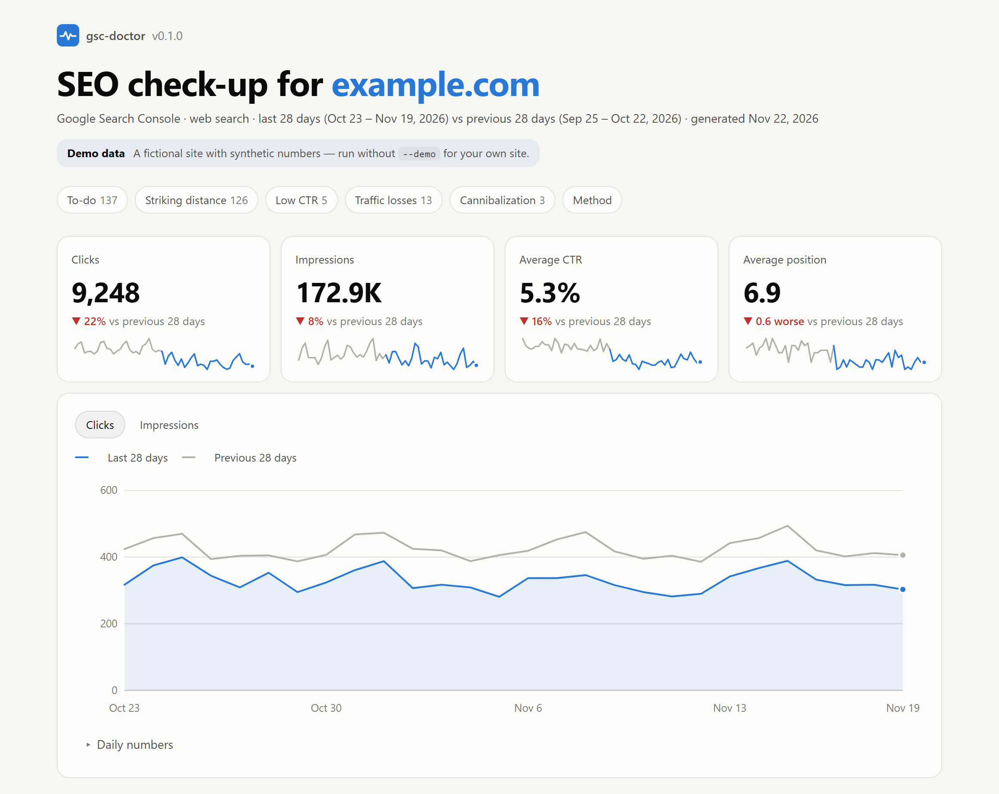
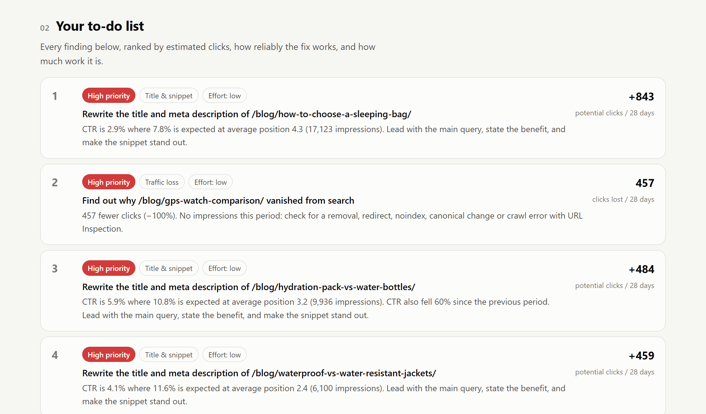
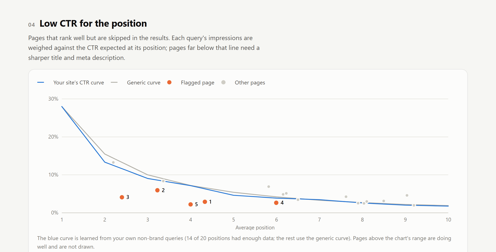

<h1 align="center">gsc-doctor</h1>

<p align="center">
  <strong>One command turns your Google Search Console data into a prioritized SEO to-do list and a client-ready report.</strong>
</p>

<p align="center">
  <a href="https://www.npmjs.com/package/gsc-doctor"></a>
  <a href="https://github.com/benmustafademirci/gsc-doctor/actions/workflows/ci.yml"></a>
  
  
  <a href="LICENSE"></a>
</p>

```bash
npx gsc-doctor --demo --open
```

No account, no setup: that builds a full report for a fictional site in under a second. When you like what you see, [point it at your own site](#connect-search-console).

<!-- Demo GIF goes here: terminal run of `npx gsc-doctor --demo --open` → report opening in the browser. -->
<p align="center">
  
</p>

## What it does

`gsc-doctor` pulls the last 28 days of Search Console data, compares them with the 28 days before, runs a set of transparent, deterministic SEO diagnostics and writes:

- a **prioritized to-do list** in your terminal, and
- a **single-file HTML report** with charts that you can open anywhere, print to PDF or send to a client. No CDN, no tracking, no external requests.

Optionally, **Gemini** turns the findings into a plain-language summary and writes new title and meta description ideas for the pages that need them.

| The question | Diagnostic |
| --- | --- |
| Which queries are a few positions away from real traffic? | **Striking distance**: positions 4–20 with real demand, ranked by the clicks you would gain in the top 3 |
| Which pages rank well but get skipped? | **Low CTR for the position**: actual vs expected CTR, judged query by query against *your own* CTR curve |
| What lost traffic, and why? | **Traffic losses**: pages and queries that dropped, labelled *disappeared*, *ranking drop*, *demand drop* or *CTR drop*, with the change split into "fewer impressions" vs "lower CTR" |
| Are my pages competing with each other? | **Keyword cannibalization**: queries where two or more pages each take a real share of impressions |
| So what do I do first? | **Priorities**: one ranked list, scored by estimated clicks × confidence ÷ effort |

<p align="center">
  
</p>

### Why another Search Console tool?

| | Exports + spreadsheets | AI assistants / MCP servers | **gsc-doctor** |
| --- | --- | --- | --- |
| Setup | manual every time | an AI client + config | `npx`, one command |
| Same answer every run | depends on you | no (LLM output varies) | **yes**, deterministic rules |
| Something to send a client | build it yourself | chat transcript | **single HTML file** with charts |
| Try before connecting an account | no | no | **`--demo`** |
| AI | none | required | **optional**, on top of the rules |

## Quick start

```bash
# 1. See a full example report (fictional data, no account needed)
npx gsc-doctor --demo --open

# 2. Check which properties your credentials can see
npx gsc-doctor sites --credentials ./service-account.json

# 3. Diagnose your site
npx gsc-doctor --site sc-domain:your-site.com --credentials ./service-account.json --open
```

Requires Node.js 20 or newer. The report is saved as `gsc-doctor-report-<site>-<date>.html` in the current folder.

## Connect Search Console

gsc-doctor only needs **read-only** access (`https://www.googleapis.com/auth/webmasters.readonly`). It ships no OAuth client of its own: you use your own Google Cloud credentials, so nobody else ever holds a token for your data.

### Recommended: a service account (≈5 minutes, works headless)

A service account is a robot Google account. You give it read-only access to your property, download its key once, and gsc-doctor can run anywhere — your laptop, a server or CI — without a browser login or tokens that expire.

1. **Create or pick a Google Cloud project** at [console.cloud.google.com](https://console.cloud.google.com/).
2. **Enable the API:** open [Google Search Console API](https://console.cloud.google.com/apis/library/searchconsole.googleapis.com) in the API Library and click **Enable**.
3. **Create the service account:** *IAM & Admin → Service Accounts → Create service account*. Any name works (e.g. `gsc-doctor`). It needs **no** Cloud roles. Copy its email — it looks like `gsc-doctor@your-project.iam.gserviceaccount.com`.
4. **Create a key:** open the service account → *Keys → Add key → Create new key → JSON*. A `.json` file downloads. Treat it like a password: don't commit it, don't share it.
5. **Give it access in Search Console:** open your property in [Search Console](https://search.google.com/search-console) → *Settings → Users and permissions → Add user*, paste the service account email, choose **Restricted** (read-only is enough) and add it. You need to be an owner of the property to do this.
6. **Run it:**

   ```bash
   npx gsc-doctor sites --credentials ./service-account.json     # should list your property
   npx gsc-doctor --site sc-domain:your-site.com --credentials ./service-account.json
   ```

   Instead of `--credentials` you can set `GOOGLE_APPLICATION_CREDENTIALS=./service-account.json`.

**Property names:** a Domain property is `sc-domain:your-site.com`; a URL-prefix property is the full URL with the trailing slash, e.g. `https://www.your-site.com/`. If you type just `your-site.com`, gsc-doctor picks the matching property for you (the Domain property when both exist).

> Your organization blocks service account keys (`iam.disableServiceAccountKeyCreation`)? Use one of the options below.

### Alternative: gcloud Application Default Credentials

If you already use the gcloud CLI, gsc-doctor picks up Application Default Credentials automatically. Google blocks its default gcloud client for non-Cloud scopes such as Search Console, so you need your own OAuth client ID ("Desktop app" type, created under *APIs & Services → Credentials*):

```bash
gcloud auth application-default login \
  --client-id-file=client_secret.json \
  --scopes=https://www.googleapis.com/auth/webmasters.readonly,https://www.googleapis.com/auth/cloud-platform
gcloud auth application-default set-quota-project YOUR_PROJECT_ID   # the project where the API is enabled
npx gsc-doctor --site sc-domain:your-site.com
```

If the OAuth consent screen is in *Testing* mode, Google expires its refresh tokens after 7 days, so you will need to log in again weekly. For unattended runs, use a service account.

### Alternative: an access token

Already have an OAuth access token with the `webmasters.readonly` scope (for example from a CI authentication step)? Set `GSC_ACCESS_TOKEN` and gsc-doctor uses it as-is.

## Gemini (optional)

Set a Gemini API key and the report gains an "In plain words" summary, concrete next steps, and two title options plus a meta description for each low-CTR page — written against the page's current title and its top queries.

1. Create a key in [Google AI Studio](https://aistudio.google.com/apikey).
2. Make it available as an environment variable — in your shell, or in a `.env` file in the folder you run gsc-doctor from (see [`.env.example`](.env.example); `.env` is git-ignored):

   ```bash
   GEMINI_API_KEY=your-key
   ```

3. Run gsc-doctor as usual. Use `--ai-lang Turkish` (or any language) for the AI text, `--model` to pick a model, `--no-ai` to skip it.

The default model is `gemini-3.5-flash-lite` (override with `--model` or `GEMINI_MODEL`). gsc-doctor calls the Gemini API's `generateContent` endpoint directly with a JSON schema for structured output. Only **aggregated findings** are sent (totals, the top issues, top queries and current titles of the flagged pages), never your raw Search Console export. On the Gemini API's free tier Google may use prompts to improve its products; use a paid key or `--no-ai` for client data. If the key is missing or Gemini fails, the report is still complete — the AI section is the only thing that changes.

## Options

```text
npx gsc-doctor [sites] [options]

  -s, --site <property>     sc-domain:example.com or https://www.example.com/  (env: GSC_SITE)
      --credentials <file>  service account key or ADC file  (env: GOOGLE_APPLICATION_CREDENTIALS)
      --demo                use built-in demo data for a fictional site
  -o, --out <file>          HTML report path
      --json <file>         also write every finding as JSON
      --config <file>       thresholds file (default: ./gsc-doctor.config.json if present)
      --brand <terms>       comma-separated brand terms, excluded from CTR benchmarks
      --days <n>            days per comparison period (default 28)
      --type <type>         web | image | video | news | discover | googleNews (default web)
      --max-rows <n>        max rows per request type and period (default 25000)
      --no-ai               skip Gemini even if GEMINI_API_KEY is set
      --model <id>          Gemini model
      --ai-lang <language>  language of the AI text (default English)
      --top <n>             actions shown in the terminal (default 10)
      --open                open the report in your browser
      --no-color            plain terminal output (NO_COLOR is respected too)
```

## Thresholds

Every rule is a plain, documented threshold. Impressions and clicks are per comparison period (28 days by default). Copy [`gsc-doctor.config.example.json`](gsc-doctor.config.example.json) to `gsc-doctor.config.json` and change only what you need; partial files are merged with the defaults and unknown keys are rejected.

| Setting | Default | Meaning |
| --- | --- | --- |
| `striking.minPosition` / `maxPosition` | 4 / 20 | Position window for striking distance |
| `striking.minImpressions` | 100 | Minimum impressions for a striking-distance query |
| `striking.targetPosition` | 3 | Position used to estimate the upside |
| `lowCtr.maxPosition` | 10 | Only pages ranking in the top 10 are judged |
| `lowCtr.minImpressions` | 300 | Minimum (non-brand) impressions per page |
| `lowCtr.maxCtrRatio` | 0.6 | Flag pages whose CTR is below 60% of the expected CTR |
| `losers.minClickLoss` / `minClickLossPct` | 10 / 0.2 | Report losses of at least 10 clicks **and** 20% |
| `losers.positionDrop` | 1.5 | Average-position drop that counts as a ranking drop |
| `losers.demandDropPct` | 0.25 | Impressions drop at a stable ranking that counts as a demand drop |
| `losers.ctrDropPct` | 0.25 | CTR drop at stable ranking and demand that counts as a CTR drop |
| `cannibalization.minImpressions` | 100 | Minimum impressions for the query |
| `cannibalization.minPageShare` | 0.1 | Each competing page needs ≥ 10% of the query's impressions |
| `cannibalization.includeBranded` | false | Brand queries (home + about page) are excluded by default |
| `ctr.model` | `"site"` | Learn the CTR curve from your data (`"default"` = generic curve only) |
| `ctr.minImpressionsForCurve` / `minQueriesPerPosition` | 50 / 5 | Data needed per position before your own curve is trusted |
| `brandTerms` | `[]` | Substrings that mark a query as branded (also `--brand`) |

## How the diagnostics work

- **Expected CTR comes from your own site.** For every rounded position 1–20, gsc-doctor takes the *median* CTR of your non-brand queries with enough impressions. Positions without enough data fall back to a conservative generic curve, and the result is forced to never increase with position. A page is judged by summing *impressions × expected CTR* over each of its queries, so a page that ranks #2 for one query and #9 for another is judged fairly.
- **Loss causes are decided in order:** no impressions now → *disappeared*; average position worse by ≥ 1.5 → *ranking drop*; impressions down ≥ 25% at a steady ranking → *demand drop* (seasonality, fewer searches); CTR down ≥ 25% at steady ranking and demand → *CTR drop* (new AI answers, rich results, a weaker snippet); otherwise *mixed*. Because clicks = impressions × CTR, every loss splits exactly into a part caused by impressions and a part caused by CTR.
- **Cannibalization ignores "jump to" links.** Search Console reports `#fragment` URLs separately; they are merged into their page before anything is compared.
- **Priorities:** `score = estimated clicks × confidence ÷ effort`. Confidence: title/snippet rewrite 0.7, striking distance 0.5, cannibalization 0.4, traffic losses 0.1–0.8 depending on the cause. Effort weight: low 1, medium 2, high 3. A page with both low CTR and a CTR-driven loss gets one action, not two.
- **Data:** complete days only (`dataState: final`), up to 25,000 rows per request type and period (raise with `--max-rows`). Search Console hides rare (anonymized) queries, so query-level totals can be lower than page totals; when too much of a page's traffic is hidden, gsc-doctor falls back to the page's average position.

Estimates are directional, not promises — every number in the report shows how it was computed.

<p align="center">
  
</p>

## Privacy and security

- Search Console data goes **directly from Google to your machine**. gsc-doctor has no server and sends no telemetry.
- The HTML report is self-contained: inline CSS and SVG, no fonts, scripts or images loaded from anywhere.
- The only optional outbound calls are to the Gemini API (aggregated findings, only with your key) and to the flagged pages themselves (to read their current `<title>` and meta description for better AI suggestions).
- Credentials stay in files you control; `.env`, `*service-account*.json` and `client_secret*.json` are git-ignored by default.

## Roadmap

- **v0.2**
  - GitHub Action: a weekly report committed to your repo or attached to a run, with keyless auth via Workload Identity Federation.
  - Alerts to Telegram and Slack when clicks drop or a page disappears.
  - Gemini CLI extension, so you can ask for a check-up from the terminal agent.
- Later: Search Console URL Inspection for vanished pages, device and country breakdowns, multi-site summaries, a Markdown report.

Ideas and pull requests are welcome — please open an issue first for larger changes.

## Development

```bash
npm ci
npm test            # Vitest, synthetic fixtures only
npm run typecheck
npm run build
node dist/cli.js --demo --open
```

The runtime has **zero dependencies**: Google auth (service-account JWTs, refresh tokens), the Search Console client and the Gemini call use Node's built-in `fetch` and `crypto`. Tests and examples use only the reserved `example.com` domain and made-up numbers.

## License

[MIT](LICENSE) © 2026 Mustafa Demirci
